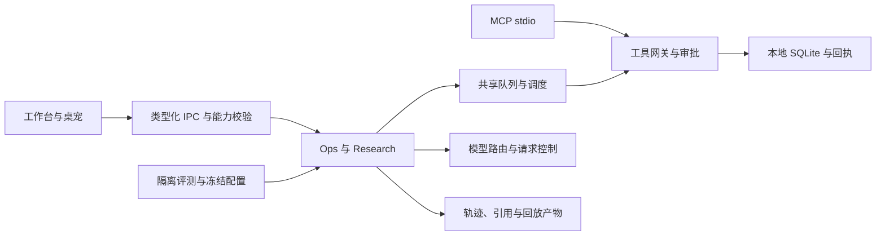

# AI Desk Companion · 事务助手

本地优先的 Windows 个人事务助手：把通知、邮件和文档中的事项整理为待办与日程，通过澄清、审批和可追溯研究辅助日常安排。

核心能力包括受控的 Ops 工具执行、基于冻结资料与码点引用的 Research 工作流，以及使用隔离案例库、固定路由和不可变配置的评测。桌宠、日历、待办、课表、提醒和邮件阅读提供日常使用入口。

### 当前验证范围

工程验证记录见 [本轮交付状态](docs/acceptance/rc1-20261002.md)。Ops v2 的 50 条和 Research v1 的 40 条离线工程案例均符合标注预期，包含正确拒绝的攻击案例。Fake 脚本使用标注构造输入，结果用于验证工程流程；真实模型效果仍需独立实验与人工复核。

当前能力包括共享队列的取消与恢复、审批幂等、关键业务与最终观察落盘、MCP 严格协议、引用清单校验、证据批次事务、检索候选上限，以及 schema 2 冻结和真实适配器的离线接线。真人桌面流程、付费模型实验、外部邮件账号和公开发布的状态逐项记录，不将界面测试视为真人验收。

### 本地运行

在 Windows 源码目录安装项目锁定的依赖。Node 环境须满足依赖要求，本轮验证使用 Node 24.19.0。先构建再执行测试，MCP 进程测试需要构建文件。

```powershell
npm ci
npm run build
npm run typecheck
npm test -- --reporter=dot
npm run dev
```

无模型配置时可先使用待办、日历和本地业务。需要 AI 功能时，在工作台设置中配置供应商、模型和运行时凭据；邮箱账号按需配置。业务模型的修复或回退与评测固定路由各自按其运行策略执行。评测不会更改业务默认供应商。

用于验收的构建可从源码启动到独立绝对用户目录，避免与日常数据混用：

```powershell
node_modules/electron/dist/electron.exe . --user-data D:/Chatgpt/acceptance/my-demo-user
```

最短合成演示可创建“准备实习面试”待办，编辑优先级，完成后重启检查状态，再查看 Agent、Research 和 Evals 页面。Ops 与 Research 的模型交互需要可用供应商；资料只使用合成内容。完整演示脚本见 [demo-script.md](docs/portfolio/demo-script.md)。

### 冻结与评测

源码形态的 CLI 在构建后可用。新实验要求对应工程代码已提交，工作区内影响执行的资源与冻结版本一致。冻结时不会发送模型请求，fake 无需凭据。

```powershell
node out/main/eval-cli.js freeze --experiment my-eval --dataset personal_ops_v2 --stage ops-planning --execution fake --user-data D:/Chatgpt/acceptance/my-eval-user
node out/main/eval-cli.js freeze --experiment my-eval --dataset research_v1 --stage research-extraction --execution fake --user-data D:/Chatgpt/acceptance/my-eval-user
node out/main/eval-cli.js run --dataset personal_ops_v2 --split dev --execution fake --config my-eval-personal_ops_v2-ops-planning-fake-baseline,my-eval-personal_ops_v2-ops-planning-fake-candidate --repeats 1 --max-cases 60 --user-data D:/Chatgpt/acceptance/my-eval-user
```

配置 ID 绑定实验、数据集、阶段、执行类型和模板。启动前重读 dataset、fixture、预算、交互、提示词、target 与代码版本；漂移会拒绝执行。配置文件与模板副本不包含 API Key。历史 schema 1 保留供既有产物读取，新冻结使用 schema 2。

真实冻结额外使用 `--execution real --target-file <绝对JSON路径>`，目标档案只有 `providerId/protocol/baseUrl/model`。CLI 凭据通过 `AI_DESK_EVAL_API_KEY` 提供，并用 `AI_DESK_EVAL_PROVIDER_ID` 明确绑定供应商；请在本机运行环境设置，不将密钥放入参数、目标档案或版本库。桌面凭据从该 provider 的已配置加密记录解析。

dev 冒烟可加 `--case-ids-file <JSON数组路径>`，清单拒绝未知、重复或 holdout ID，并绑定续跑。CLI 退出 0 表示运行进入终态；案例是否达标必须检查 passed/failed/not_run 和覆盖率。真实调用应先确定发送范围和费用上限，540 个案例执行与模型请求次数分别计算。

### MCP 与技术结构

开发版先构建，然后在独立目录启动 stdio MCP。写入工具生成提案，经同一目录的桌面审批后执行；同一用户目录不能同时被两个应用实例占用。

```powershell
node_modules/electron/dist/electron.exe . --mcp --user-data D:/Chatgpt/acceptance/my-mcp-user
```

配置与工具清单见 [mcp-connection.md](docs/mcp-connection.md)。



锁文件版本为 Electron 44.4.3、React 19.3.0、TypeScript 5.9.3、sql.js 1.14.2、Vitest 5.0.1。主进程承担业务、持久化、检索与模型请求；renderer 消费受控 IPC；shared 定义跨进程契约。检索读取候选最多 500 条；历史资料缺少 record_scope 时明确显示未核验提示。

### 打包与交付

`npm run dist` 生成 Windows x64 便携包及 build-info。资源检查使用 `node scripts/check-build.mjs`，包内检查使用 `node scripts/check-build.mjs --packaged <win-unpacked绝对目录>`。具体包、SHA-256、构建提交和本地验证见交付状态；这里只登记实际存在的产物，不提供未发布下载链接。

CLI 当前按源码 Node 依赖运行。便携包内使用桌面 Evals 入口，不能直接把开发 CLI 命令当作已验证的包内命令。远端 CI 和外部发布分别登记，本地构建通过不代表远端 CI 已运行。

### 求职材料与限制

[项目卡](docs/portfolio/project-card.md)、[项目叙述](docs/portfolio/project-story.md)、[简历描述](docs/portfolio/resume-bullets.md)、[失败案例](docs/portfolio/failure-cases.md)、[面试笔记](docs/portfolio/interview-notes.md) 与 [演示脚本](docs/portfolio/demo-script.md) 提供可追溯的展示内容。个人主页目标仓库尚未提供，可先使用项目卡文案；没有公开链接的入口保持明确说明。

模型可能答错，引用结构有效也不代表语义支持，Research 真实结果需逐对人工审阅。当前评测规模较小，不能推导真实用户表现或统计显著提升。邮箱、图片/PDF课表与提醒等既有功能仍按各自验收记录限定范围。

### 版权与素材

本项目代码版权归作者 MoMingYuYor 所有，保留所有权利。公开展示不自动构成开源许可；复制、修改或再分发需要作者许可。第三方依赖按各自许可使用，桌宠素材来源见 [ASSET-SOURCES.md](src/renderer/pet/assets/ASSET-SOURCES.md)。本轮未替作者变更许可证或公开发布范围。
