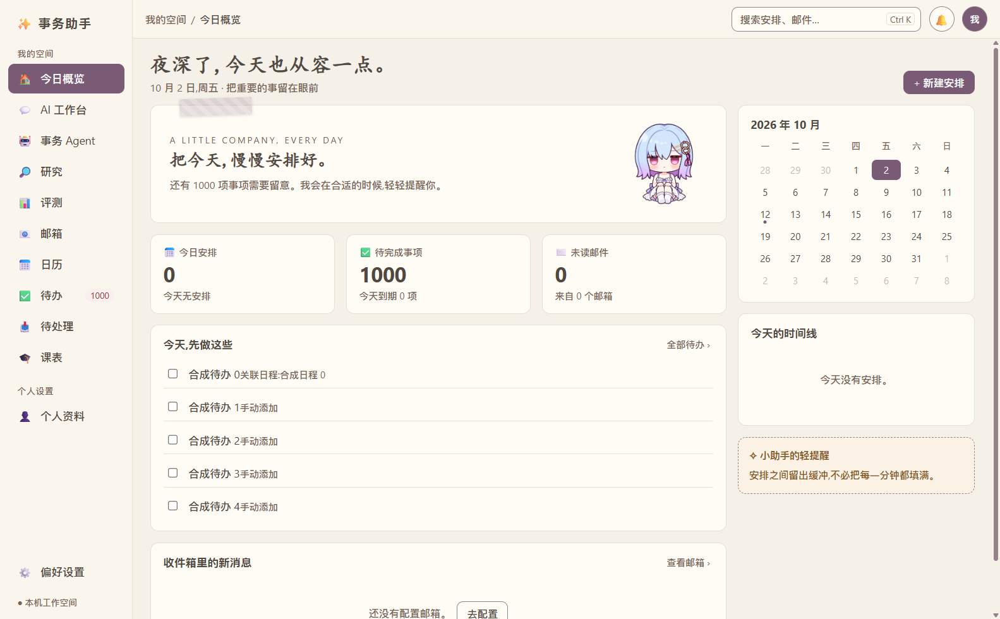
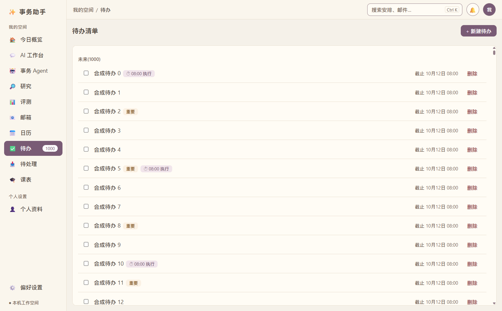
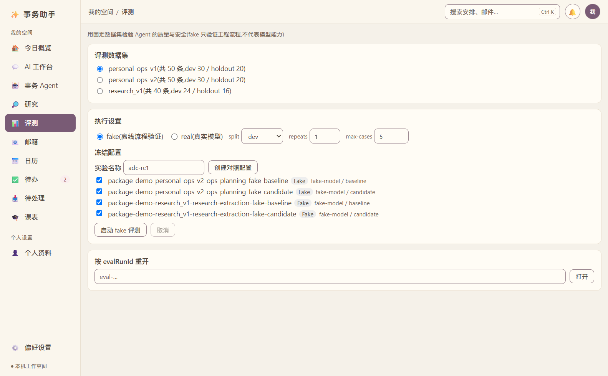

# AI Desk Companion 项目卡

AI Desk Companion 是面向个人事务的本地 Windows 桌面应用，结合待办、日历、通知分析、桌宠和受控 AI 工作流。项目面向 AI 应用开发实习展示，可讲清“模型提出方案、系统校验、用户确认、业务保存、结果可追溯”的完整过程。

技术栈使用 Electron、React、TypeScript 与 sql.js。Ops 与 Research 共用执行队列；工具按风险分级，写入由审批、目标版本和幂等回执约束。Research 对冻结资料进行检索、证据抽取和引用，使用 Unicode 码点范围定位并验证 record_scope。评测将案例库、模板、代码版本和模型目标绑定，支持离线流程验证和固定路由的真实适配器。

本人职责可据实际工作填写为需求选择、方案理解、AI 辅助开发、测试结果核查及演示准备。面试时应能现场解释代码与失败边界，不能将 AI 生成内容全部描述为本人独立设计。当前离线工程数据为 Ops v2 50 条、Research v1 40 条，均符合标注预期；攻击正确拒绝包含在该结果中。数据不是用户数量，fake 成绩不是模型准确率。

项目源码位于本地 D:/Chatgpt/待办。Windows x64 便携包已经在本机生成，具体路径、SHA-256、未签名状态与验证范围见验收记录。公开源码地址、下载地址、演示视频和个人主页路由尚未登记。

### 实际界面

工作台与待办来自提交 2a75c25 的真实 Electron 窗口，使用独立合成数据。

包内评测图显示已经创建的两个模块配置。自动验证完成四项 fake 执行及产物回放；截图本身只证明页面与配置显示。澄清、完整审批影响、引用高亮、冲突与对比结果图仍需实际流程素材。

证据入口为 [本轮验收记录](../acceptance/rc1-20261002.md)、[失败案例](failure-cases.md) 和 [演示脚本](demo-script.md)。真实模型对照、人工语义支持审阅和真人桌面验收仍按记录分别标注。本项目适合展示 AI 工程闭环，目前不能宣称生产级稳定性或真实模型显著提升。
