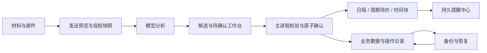

# 事务助手技术设计与实施路线

日期：2026-09-20。状态：需求范围已确认，本文定义拟实施的技术方案与验收条件，各实施阶段均未开始。

## 1. 目标、范围与基线

本轮目标是提高本地数据的可靠性，补齐事项处理、执行安排和提醒闭环，并提供可控的模型数据发送与 Gmail 浏览器授权。产品继续面向 Windows 个人使用，保留本地优先、人工确认事项、收件与阅读不调用模型、应用不发送邮件的边界。

已确认范围为 R1—R10 全部缺陷修复、O1—O6 全部工程优化，以及 F1、F2、F4、F6、F7、F8、F9、F11。F12 签名与更新在上述范围完成后实施。F3 自动推荐空闲时段、F5 材料全文检索、F10 日历交换不在本轮范围内。手动选择时段时的冲突校验属于基础正确性，不扩展为 F3；O1 只完善已有搜索，不扩展为 F5。

审查基线为应用 0.1.0、数据库 schema v3、Electron 37.10.3、React 19、TypeScript、sql.js。2026-09-20 审查执行的 69 个测试文件、419 个用例、双端类型检查与生产构建均通过；依赖审计报告 4 个受影响包。上述是审查时结果，不代表本文功能已开发或安全问题已修复。Windows 长驻、真实邮箱和模型服务、实际安装与更新仍需独立验收。

本文中的表结构、接口名称、默认值和模块路径均是实施设计。需求编号与范围已由用户确认，技术细节按本文件组织；实施中的必要变更须同步修改受影响契约及验收条件。现有产品入口见 [产品设计文档](产品设计文档.md)，阶段记录见 [开发计划](开发计划.md)。

数据字段约束、幂等顺序、迁移分组及具体场景见 [数据契约与验收细则](数据契约与验收细则.md)；S1 的文件责任、失败测试和执行步骤见 [可靠性底座实施计划](superpowers/plans/2026-09-20-reliability-phase1.md)。三份文档分别承担范围与方案、跨模块契约、逐任务执行职责，实施时须保持一致。

## 2. 需求追踪与完成判据

| 编号 | 工作内容 | 完成判据 | 阶段 |
| --- | --- | --- | --- |
| R1 | 备份导入完整性校验 | 空对象、缺表、错误版本、坏行均在替换前拒绝；原库不变；合法空库可恢复 | S1 |
| R2 | 持久化可确认 | 写失败可见且可重试；关键操作完成后重开数据库仍能读到结果 | S1 |
| R3 | 窗口及 IPC 权限 | 非应用页面、子框架和无权限窗口不能调用敏感接口 | S1 |
| R4 | 密钥安全存储 | 加密不可用时拒绝持久保存；已有明文降级记录受控迁移 | S1 |
| R5 | 网页抓取边界 | 限制实际读取字节；逐跳地址检查；内网及特殊地址默认拒绝 | S1 |
| R6 | 提醒时间窗口 | 仅按实际触发时间补报过去 24 小时，边界可重现测试 | S1、S3 |
| R7 | 日程校验与转换 | 无效区间不能保存；待处理转换与状态更新原子提交 | S1、S2 |
| R8 | 会话事件隔离 | 其他会话和旧任务的事件不能更改当前流状态 | S1 |
| R9 | 邮箱初始同步范围 | 近期空邮箱不拉取全部历史；初始化期间新邮件不丢失 | S1 |
| R10 | 邮箱任务生命周期 | 停用、移除、退出后无迟到写入；单账号取消不影响其他账号 | S1 |
| O1 | 搜索定位与并发 | 命中直达具体条目，旧请求不能覆盖新查询 | S2 |
| O2 | 性能基准与优化 | 固定数据集采集基准，分页和索引改善有对照，禁止无界扫描 | S1—S5 |
| O3 | 模块职责拆分 | 数据访问、业务服务、IPC 和视图分离，迁移期间无两套业务规则 | S1—S4 |
| O4 | 错误反馈和诊断 | 统一错误码，失败保留编辑内容，日志不含密钥和正文 | S1—S5 |
| O5 | 测试与交付 | CI 执行检查；真实打包、迁移、休眠及故障场景单独留证 | S1—S5 |
| O6 | 日常可用性 | 键盘可完成核心操作，支持受控撤销，跨日跨月刷新，构建缓存判断完整 | S2、S5 |
| F1 | 改期及取消匹配 | 差异预览、人工选中、版本校验、幂等应用和有冲突保护的撤销 | S2 |
| F2 | 待确认工作台 | 缺失信息补全、原文出处、冲突提示、逐项结果及原子转换 | S2 |
| F4 | 提醒中心 | 查看状态、稍后提醒、免打扰、测试通知与重启恢复 | S3 |
| F6 | 周期日程和待办 | 每天、每周、工作日重复；单次和本次以后修改语义明确 | S3 |
| F7 | 子任务与时间块 | 单层子任务、预计耗时、一项任务多时间块，截止与执行独立 | S3 |
| F8 | 自动备份恢复 | 轮换、校验、预览、恢复前快照、可移植的分析材料附件 | S3、S5 |
| F9 | AI 透明度与隐私 | 发送前选择快照、授权模型范围、取消、重试审计与用量显示 | S2、S4 |
| F11 | Gmail OAuth | 系统浏览器授权、续期、撤销、只读同步、真实账号验证 | S4 |
| F12 | 签名与更新 | 受信分发、可控安装、失败恢复及真实版本升级验证 | S6，最后 |

## 3. 架构选择与模块边界

采用基于现有 Electron 应用的渐进式改造。保留 sql.js 并先补齐可靠落盘、业务事务和故障反馈，再以实测决定是否调整存储实现。直接重写原生数据库会同时影响迁移、备份、打包和测试；一开始引入云端同步则超出本轮个人本地应用范围。

渲染层仅持有显示状态与用户输入；主进程承担权限、参数校验、业务操作、持久化和外部连接。AI 输出、备份文件、网页及邮件都按不可信输入处理。下表是职责目标，新目录按实际任务逐步建立，避免先搬文件再补行为。

| 模块 | 主要路径 | 职责 |
| --- | --- | --- |
| 公共契约 | `src/shared/api.ts`、`types.ts`，新增 `operations.ts`、`planning.ts`、`reminders.ts`、`backup.ts`、`privacy.ts` | 请求、结果、错误码、版本与运行时校验契约 |
| 权限边界 | 新增 `src/main/security/ipcPolicy.ts`、`urlPolicy.ts` | 窗口及框架校验、网络目标限制 |
| 数据层 | `src/main/db/connection.ts`、`schema.ts`，新增 `migrations/`、`repositories/` | 迁移、读写、索引和持久化；逐步拆分 `dao.ts` |
| 事项流程 | 新增 `src/main/planning/` | 候选转换、改期取消、周期实例、子任务和时间块 |
| 提醒 | 新增 `src/main/reminders/` | 持久任务、调度、免打扰与触达记录；替换原服务内部逻辑 |
| 备份 | 新增 `src/main/backup/` | 归档、校验、轮换、恢复及排他写入协调 |
| AI 请求 | `src/main/services/engine.ts`、`modelRouter.ts`、`context.ts`，新增 `src/main/privacy/` | 快照准备、授权检查、运行状态和脱敏观测 |
| 邮箱 | `src/main/mail/`，新增 `oauth/`、`gmail/` | 独立认证与 Gmail 只读适配；复用正文、来源和分析流程 |
| 界面 | 现有 `pages/`、`mail/`、`search/` | 工作台、日程编辑、任务详情、提醒中心、恢复向导与发送预览 |

共享 schema、IPC、preload、锁文件和应用入口由集成负责人维护。子任务按模块分配写入责任；同文件的并行只读审查可以进行，写入须串行集成。拆分结束后删除重复代码和闲置入口，旧数据兼容通过有版本的迁移实现。

## 4. 可靠性与安全基础

### 4.1 持久化与业务提交

数据库保存器维护 `dirty / saving / saved / failed` 状态与递增写入代数，普通写入保留 400ms 合并，最长 2 秒必须尝试落盘。失败以 1、5、30 秒退避重试，之后每 30 秒重试；磁盘错误持续时界面显示未保存状态，避免成功提示掩盖风险。每次成功只清除已落盘代数的脏状态。

关键业务命令的成功响应必须在其事务提交并成功持久化之后返回。事务已在内存提交而落盘失败时，返回 `PERSIST_FAILED` 与操作 ID，保留待保存记录并阻止重复创建；进程仍运行时按同一操作 ID 重试保存并恢复结果。若进程已退出，以重新打开的磁盘库及其中操作回执为准：有回执则返回已落盘结果，无回执则提示此前保存未确认，并重新读取状态、校验后允许用户重试。首版不承诺恢复已丢失的内存事务，也不假设操作回执可独立于数据库写失败而存活。恢复备份的失败处理更严格，必须回到恢复前的数据快照，不能继续让界面使用半恢复数据。临时文件写入、刷新、替换和启动时损坏识别都通过故障注入测试。

所有修改型命令携带 `operationId`；更新现有实体另带 `expectedRevision`。新增 `operation_receipts` 保存请求摘要、结果引用及完成状态；重复 ID 与相同请求返回同一结果，不同请求返回冲突。`events`、`todos`、`pending_items` 增加 `revision`，以事务内条件更新实现乐观锁。仅依赖前端禁用按钮不能满足幂等要求。

### 4.2 IPC、密钥与网络

生产窗口只允许精确应用页面路径，开发窗口比较解析后的协议、主机、端口与允许页面路径。IPC 校验发送方是已登记窗口的当前主框架；来源未知时拒绝。工作台拥有经校验的业务修改权限，桌宠只拥有材料接收、显示与拖动等必要权限，今日面板默认只读；任何扩权显式登记。preload 不向非应用文档暴露完整能力。

模型密钥与邮箱令牌统一由系统安全存储加密。发现 `plain:` 历史记录时，在加密可用的环境中原子迁移；不可用时保持账号待处理，禁止继续使用明文持久化，新输入可仅驻留当前进程内存。日志、备份和渲染层均不得接收可还原凭据。

网页请求只接受 HTTP(S)，默认拒绝环回、私网、链路本地、多播、未指定及保留地址，覆盖 IPv4、IPv6 和映射地址。每次重定向重新检查，DNS 结果与实际连接目标绑定，限制重定向次数并防止解析后地址变化绕过检查。按解码后的响应字节流执行 2 MiB 硬上限，超限中止读取；`Content-Length` 仅作为提前拒绝依据。为本地模型服务配置的端点属于独立用户配置域，不能因此放宽网页抓取策略。

### 4.3 时间与提醒修复

日程写入统一检查可解析日期、非空标题和有效区间。默认普通日程必须 `endAt > startAt`，缺失结束时间时在编辑预览中给出 30 分钟建议，用户可修改；不直接创建零时长日程。全天事项按日期解释，查询转换规则集中处理，避免各页面自行拼接边界。

补报按 `fireAt` 与当前时刻计算，范围为 `[now - 24h, now]`。不依赖事件开始/结束时间猜测提醒是否到期；允许提前数天提醒的事项也能被查询到。超出补报窗口、已取消或已完成的事项在生成通知前过滤；日程结束时间已过不单独取消窗口内补报。操作系统通知提交成功仅表示已交给系统，不表示用户已经阅读。

### 4.4 邮箱与会话生命周期

账号级任务注册表管理自动同步、手动同步、历史加载及内容读取。停用或移除首先提升账号生命周期代数、取消任务并等待提交边界退出，任何异步结果在写入前核验该代数。移除后的旧响应不得重建账号、缓存或游标。退出流程停止新任务并等待必要保存；超时须记录未完成任务，下一次启动安全恢复。

IMAP 初始化固定打开邮箱时的 UID 上界，仅用最近 30 天检索结果建立初始内容，然后从固定上界补收新邮件。空窗口也更新初始化游标；UIDVALIDITY 变化必须重新确认远端身份。会话流事件统一包含 `conversationId + runId`，视图只接收当前活动请求的结果，取消、切换和旧分析完成不能覆盖新状态。

主进程在流式内容前发送带递增 runGeneration 的 started 事件，视图先绑定 runId；页面切回通过活动运行快照恢复文本，并用文本序号避免和在途增量重复。视图切换不取消其他会话的后台任务；取消和重试只使指定运行失效。恢复数据库后旧运行和旧快照按 workspaceEpoch 作废。

## 5. 事项确认、改期与撤销（F1、F2）

候选必须拥有程序生成的稳定身份及不可变来源快照。现有分析 JSON 保留，新增 `action_candidates` 作为工作台投影，字段包括 `id`、`analysis_id`、`candidate_key`、`kind`、`payload`、`source_snapshot`、`status`、`revision`。同分析版本与候选键唯一；不同分析版本不会以数组位置相同而误认为同一候选。旧 `pending_items` 保留原 ID，并迁移为可手动处理、来源可能缺失的条目。

改期匹配先查询已有来源和确认关系，再按事项类型、标题、时间、地点形成有限候选列表。模型的置信度只作为提示，不能当作身份凭据；主进程重新验证实体存在、归属、当前版本和允许修改字段。首版只修改日程及待办，课程与校历仍走现有专用编辑流程。找不到确定目标时停留待确认，不自动覆盖或创建替代事项。

界面并列展示原值、拟修改值、通知出处、关联时间块及受影响提醒。取消以业务取消状态表示；改期保留事项 ID 并更新版本，重新安排受影响提醒。重复事项在 F6 接入后增加本次/本次以后范围选择，默认仅本次，未经明确选择不批量改变系列。

待确认工作台支持按缺失字段、时间冲突、处理状态和来源筛选；可以补全字段、修改目标、忽略或提交选中项。批量操作逐项返回结果，一项失败不撤销其他已经明确成功的独立事项；每一项的正式事项写入、来源绑定、待确认状态更新和操作回执必须在一个事务中完成。输入校验失败保留用户编辑内容。

新增 `entity_changes` 保存实体引用、前后版本、允许恢复的业务字段、操作来源和撤销状态。撤销只在当前实体版本仍等于该操作生成版本时执行，否则展示冲突；撤销本身也是有幂等 ID 的操作。业务记录与脱敏诊断日志分离，备份对操作记录的包含范围明确展示。普通删除提供短时撤销，确认“永久删除”时明确不可恢复及备份中可能仍有副本，不承诺即时物理擦除。

## 6. 周期事项、子任务与时间块（F6、F7）

首版重复规则支持每天、每 N 周的指定星期、周一至周五工作日，以及按截止日期或次数结束。工作日不等同于法定节假日调休；月末、农历、外部日历规则不纳入首版。

新增 `recurrence_series` 保存 `id`、`entity_kind`、`template`、`rule`、`timezone`、`start_local`、`until_local`、`count`、`revision`、`parent_series_id`。`recurrence_instances` 以不变的 `logical_instance_id` 为主键，保存当前系列、原始发生时间 `occurrence_key`、实际实体 ID、序号及实例状态，并设唯一约束 `(series_id, occurrence_key)`。单次改期不改变逻辑 ID 或原实例键；系列拆分需要更换系列键时，以 `recurrence_instance_keys` 保留旧键到逻辑 ID 的唯一映射，已确认事项的实体 ID 和来源绑定不变。`recurrence_exceptions` 按逻辑 ID 记录单次覆盖或取消，不能用改后的实际时间生成第二个实例。

已有一次性事项不转成周期系列，不改变原 ID。未来实例按需查询、按有界窗口物化：提醒任务维护未来 90 天，启动及跨日补齐；日历查询更远时间可即时计算预览，编辑时才物化。算法跳到查询窗口，不从很久以前逐日遍历；补报仍只覆盖最近 24 小时，不为多年未启动生成大量旧实例。

新系列保存创建时的 IANA 时区及墙钟时间；周期按该时区计算，用户换时区不自动改动系列。夏令时不存在的时间顺延到第一个有效时刻，重复时间采用较早偏移，并在实例预览中显示实际安排。旧本地朴素时间保留含义，不在迁移时猜测历史 UTC；首次创建系列时明确当前时区。

“仅本次”写入异常，不改变其他实例。“本次及以后”在选中实例处截断原系列并建立新系列，事务内处理未来未完成实例、例外、时间块和提醒；完成记录与历史实例保持原归属。预览列出新旧发生项的对应关系；已物化且对应确定的实例保持逻辑 ID、实体 ID、来源与单次例外，无法对应的例外或时间块必须由用户选择保留为一次性事项或取消后才能提交。共享时间块不自动删除。周期待办完成只作用于本次，未来实例不因完成当前项而重复生成；F1 修改周期项同时核验系列、实例及例外的 revision。

`todos` 增加 `parent_id`、`estimated_minutes` 和 `execution_status=todo|doing|done`。`done` 与已有 `completed_at` 在同一事务内同步，不能出现完成标记互相矛盾；旧未完成事项迁移为 `todo`。首版仅一层子任务，主进程禁止循环、自己作为父项及跨周期实例误挂；完成父任务时若有未完成子任务，提示选择返回处理或显式一并完成，不静默修改子项。

新增 `todo_time_blocks(todo_id, event_id, created_at)`，以 `(todo_id, event_id)` 唯一，一项任务可有多个时间块。旧数据可能存在多个待办关联同一日程，迁移保留全部关系和原日程 ID；编辑共享日程时显示所有受影响任务，删除单一关联不删除日程。旧 `linked_event_id` 迁移到关系表，界面和内部接口统一改为多时间块，再移除旧字段和旧业务路径。时间块修改只影响执行安排；截止时间独立保存，时间块超出截止或与课程、日程冲突时展示提示。首版由用户选择时间，不自动推荐空闲时段。

## 7. 提醒中心（F4）

新增 `reminder_jobs` 保存 `id`、目标实体及逻辑实例 ID、`target_revision`、`scheduled_at`、`snoozed_until`、`status`、`attempt_count`、`last_error_code` 和时间戳；状态为 `scheduled / deferred / dispatching / uncertain / submitted / acknowledged / cancelled / expired / failed`。`reminder_attempts` 记录每次系统提交与重试结果，幂等键覆盖实体、稳定逻辑实例 ID、提醒规则版本和触发时间。单纯修改标题或备注只更新展示与目标 revision，不增加规则版本或重发通知。

调度器独立于 AI，应用启动、每 30 秒、休眠恢复和事项变更时检查。提交前将任务转为 `dispatching` 并持久化，成功后记录 `submitted`；启动时将未完成的提交归为状态不确定，在提醒中心显示并允许重试。系统通知没有端到端恰好一次保证，不能把系统 API 返回等同于用户接收。

稍后提醒提供 5、15、60 分钟和指定时间，新时间持久保存，不修改事项本身。免打扰默认关闭，启用后用户设置本地开始与结束时间；时间段跨午夜时正确计算。期间任务转为 `deferred`，结束后按 24 小时窗口合并提示，超出窗口仅留历史，不逐条轰炸。完成、取消或改期在同一业务提交中使旧任务失效。

提醒中心提供待提醒、已提交、已确认、失败和过期筛选，并可定位原事项。测试通知与业务任务分离，不产生正式提醒历史。应用完全退出时不提供后台触达，不在本轮安装系统服务；界面明确说明托盘驻留与退出的区别。

## 8. 备份与恢复中心（F8）

### 8.1 格式与自动备份

新归档使用带清单的单文件容器，清单包含 `app`、`formatVersion`、`schemaVersion`、导出时间、业务表记录数、附件相对路径、大小和 SHA-256。校验和用于完整性校验，不宣称能验证备份来源真实性。业务数据包括事项、系列、实例、时间块、候选、来源、业务变更记录及必要提醒状态；不包含 API Key、OAuth 令牌、邮箱授权码、邮箱收件缓存、浏览器会话和本机外观偏好。

分析使用过的材料副本按内容哈希归档；路径只能解析到受控材料目录，不能沿旧 `materials.path` 任意读取本机文件。旧材料通过明确的复制步骤纳入受控目录，缺失或不可读取的文件列入清单和界面告警，不把文本恢复成功宣传为附件完整。备份可能包含已分析邮件正文，创建和导出界面说明这一点；归档默认不宣称已加密。

自动备份首次默认关闭，由用户启用并选择目录。建议默认每日一次、保留最近 14 份成功归档；应用退出期间不运行，重启后只补一次。先写临时文件，完成校验后原子改名，最后再清理超出保留数量的归档；只清理应用自身清单登记的文件，失败不删除最后一份有效备份。空间不足、目录失联及备份失败在中心显示，不能悄悄停用。

### 8.2 校验、恢复与迁移

读取旧 JSON 时按其明确的 schema 版本执行专用导入器：验证该版本必需表和字段，只对已知旧版本缺少的新表提供显式迁移默认值。`{"tables":{}}`、未知未来版本和缺失必需表都拒绝；合法空备份必须具有完整表集合与有效清单。归档拒绝绝对路径、路径穿越、符号链接、重复成员、过量成员及超过界面声明上限的解压体积。

恢复分为“校验并预览 → 用户确认替换 → 暂停新业务写入 → 排空在途任务 → 持久化并创建恢复前快照 → 应用并落盘 → 重建调度 → 恢复服务”。预览显示各类增减数量、缺失附件、备份时间和版本，并明确哪些本机凭据与设置会保留。数据库、提醒、邮箱、分析和材料摄取共用恢复写入闸门，迟到任务因恢复代数失效而拒绝提交。快照在排空后形成，覆盖恢复开始前所有已接受的修改；快照失败时不替换原库，释放闸门并报告错误。

附件先解压到校验过的全新受控目录，业务恢复事务只引用这一完整目录。原材料与恢复前库在新库成功落盘前保持可用；失败时恢复内存及磁盘快照，清理仅作为后续受控工作，不把文件系统与 SQL 误当作一个原子事务。启动时可识别中断恢复标记并回到一致状态。

恢复替换的是业务状态，当前邮箱配置和凭据保留；分析来源中不存在的缓存引用置空。当前库的提醒去重记录不得泄漏到恢复后的业务中。新备份恢复其已提交/确认状态并重算待触发任务；旧备份没有提醒状态时，默认只安排未来提醒，将过去事项标为历史，预览中可选择补报最近 24 小时。恢复不得使多年前的事项集中弹窗。

schema v3 之后逐模块递增迁移版本，每个迁移有前置版本、事务、成功后持久化和重入保护。发布时只提交已实现模块的迁移，禁止预创建后续空表来宣称完成。打开未知更高版本数据库时拒绝写入；应用二进制回退必须配套兼容的数据快照，不能直接让旧程序打开新 schema。

正常版本升级须将旧 `fired_reminders` 转为可识别的已提交记录，保留原触发键与时间，避免升级后再次通知；无法关联到现存事项的记录保留为迁移历史，不生成新任务。旧备份恢复缺少提醒状态与正常数据库升级是两条独立路径，不共用“清空已提醒状态”的处理。

## 9. AI 请求透明度与隐私（F9）

新增发送前预览，显示本次正文、附件、网页材料、会话历史、个人画像、日程与课程上下文，以及允许接收这些内容的模型服务商。默认采用“每次发送前确认”；用户可主动设置明确范围的入口策略，策略变更可撤销。桌宠拖入先完成本地接收与解析，再展示待发送状态；不能让拖入自动发送绕过隐私选择。邮箱依旧必须由用户主动点击分析。

主进程生成不可变 `AnalysisRequestSnapshot`，包含选中的材料内容哈希、上下文版本、允许服务商集合与策略版本。每个获准接收方绑定 `providerId`、规范化 `baseUrl`、允许的模型 ID 和配置修订号，不仅记录服务商显示名。预览确认绑定 snapshot ID，实际请求重新检查内容及接收方配置；内容、端点或模型范围改变，以及备用模型超出已授权范围时重新预览。快照不保存可还原密钥；发送器不允许通过未授权的跨源重定向传送请求。取消勾选的材料不能通过旧会话历史、先前摘要或重试反馈重新注入；历史消息中包含这些内容时默认排除该段历史，界面显示影响。

网页内容获取与模型发送分为两个动作：用户在预览中看到待抓取链接，抓取经过网络安全策略并可取消；未经策略许可不因拖入而请求外部网页。模型自动修复、重试、备用切换都受同一快照约束，不重新拼接全部个人资料。取消立即阻止新请求与迟到提交，界面不承诺撤回已经发送给第三方的数据。

新增 `analysis_runs` 和 `analysis_attempts` 保存运行 ID、快照引用、实际模型、耗时、重试原因、状态以及服务商返回的 token 数。未提供 token 或价格时显示“不可用”，不编造费用。诊断日志只包含 ID、错误码、耗时和大小，不记录正文、授权头、令牌或完整模型原始响应；用户查看历史分析仍通过既有受控业务数据读取。

## 10. Gmail 浏览器授权（F11）

首选桌面 OAuth 授权加 Gmail API 只读适配器。继续在既有 IMAP 上接 XOAUTH2 的实现改动较小，但要求全邮箱权限，与产品只读范围不匹配；Gmail 官方建议不需要该权限的应用使用更细粒度 Gmail API 权限。因此本设计采用 `gmail.readonly`，保留现有 IMAP 密码账号路径，不自动切换账号或重用不同协议游标。[Gmail OAuth 协议说明](https://developers.google.com/workspace/gmail/imap/xoauth2-protocol)

授权在系统浏览器进行，使用已注册桌面应用客户端、PKCE S256、随机 `state` 和绑定 `127.0.0.1` 随机端口的短期回调。匹配回调路径、状态和授权会话，成功、取消或 5 分钟超时即关闭监听。授权码、校验器和 access token 不交给渲染层；refresh token 由系统安全存储加密。桌面客户端不能依赖内置 client secret 保密。[Google 桌面授权文档](https://developers.google.com/identity/protocols/oauth2/native-app)

账号新增 `auth_type=password|google_oauth`、`transport=imap|gmail_api`；Gmail 单独保存字符串类型的 `messageId`、`threadId`、`historyId` 和同步检查点，不能伪造 IMAP UID 或把 historyId 转为可能溢出的 JavaScript 数字。为协议身份建立独立远端映射，复用本地邮件 DTO、缓存、来源和候选确认。

令牌交换后通过 Gmail `users.getProfile` 核对实际授权邮箱，并与当前接入会话和本地账号绑定。浏览器选择其他账号时展示实际身份，由用户选择新增该账号或重新授权，禁止复用原账号标签、游标及缓存；同一身份重复接入执行去重。REST 正文与附件分别按 Gmail message ID 和 attachment ID 读取，不进入现有 UID/IMAP part 下载路径；共享缓存、安全处理和界面 DTO，并沿用实际流量限额。

初次同步仍限制 INBOX 近 30 天，历史由用户请求向前加载。初次列表前记录增量检查点，提交后补收期间变化；后续按 history 增量处理并过滤到产品范围。history 检查点过期时执行已管理范围的重新同步并去重，不直接无限拉取所有邮件。收到本地已分析邮件的远端移除记录时保留分析来源，只更新远端可用状态。[Gmail 同步规则](https://developers.google.com/workspace/gmail/api/guides/sync)

同账号令牌刷新合并为单个在途请求；授权撤销或 `invalid_grant` 后进入需重新授权状态，不无限重试。移除账号清理本地令牌；用户选择撤销时尝试调用撤销端点，网络失败明确提示尚未确认远端撤销。同步、正文与附件下载不调用 AI，也不修改服务器已读或执行发送操作。

`gmail.readonly` 仍属于受限权限。OAuth 项目、桌面客户端 ID、同意屏幕、测试账号及公开分发审核是外部交付条件；不因使用只读权限就宣称免审核。公开版本还需核查用户主动将 Gmail 内容交给其模型服务商分析的实际数据流是否满足 Google 要求。未完成相关审核或真实账号测试时，状态保持“代码可测／公开接入待验证”。[Gmail 权限分类](https://developers.google.com/workspace/gmail/api/auth/scopes)

## 11. 工程优化与可用性（O1—O6）

搜索接口接收类型、关键词、分页游标和请求 ID，由主进程按需检索既有字段，不把全部数据拉到渲染层。命中携带实体类型、ID、日期及必要父 ID，路由通过这些信息打开对应邮件、会话、待办、日程日期或待确认项。目标不存在时给出解释，失败状态与空结果分开，旧请求不得覆盖新结果。新增实体与字段的搜索覆盖随对应功能实现，不增加材料全文索引。

建立包含 1,000 和 10,000 条日程/待办、10,000 封邮件元数据及典型材料的固定合成数据集，记录测试机器、版本、冷暖启动、查询耗时、数据库落盘耗时和主进程事件循环延迟。初始目标为暖态查询 P95 不超过 300ms、常规交互不出现连续 100ms 以上的主线程阻塞；这是工程验收目标，需测量后附环境说明。只针对超标路径增加索引、分页、缓存或 worker，不用换数据库掩盖缺少基准。

统一 `AppError` 含 `code`、可展示消息、`retryable` 与关联操作 ID，至少覆盖 `VALIDATION`、`FORBIDDEN`、`CONFLICT`、`PERSIST_FAILED`、`BACKUP_INVALID`、`AUTH_REQUIRED`、`NETWORK`、`CANCELLED`。页面保存失败保留输入和焦点；查询失败展示重试，不转换为空列表。日志轮换并提供用户主动导出诊断包，导出前预览内容与脱敏范围。

核心控件使用语义按钮、标签与可见焦点；对话框支持焦点进入、退出和 Esc；会话列表、日历日期、日程编辑和搜索结果支持键盘操作。跨日、跨月、系统时间变化及休眠恢复统一使日期依赖缓存失效。减少动态效果、深浅主题、多屏缩放和桌宠透明背景保持回归覆盖。

构建缓存判断覆盖源码、资源、构建配置、package.json、锁文件、preload 与全部渲染入口；任一必需产物缺失即重新构建。新增 lint/format 检查与 CI，逐步处理已有问题，避免无关全库格式化。安装使用锁文件，依赖升级逐步验证，并记录依赖审计的适用性与剩余风险。Electron 升级到实施时仍受支持的稳定版本；升级是前期安全工作，不推迟到 F12。

### 11.1 业务接口契约

以下是新增或替换的业务接口，字段在对应 shared 契约模块集中定义。所有写入接口统一返回成功结果或带关联操作 ID 的 `AppError`；只读接口不产生隐式业务写入。表中权限是业务权限，仍需通过第 4 节的窗口与主框架检查。

| 接口 | 输入与结果 | 权限及提交规则 |
| --- | --- | --- |
| `previewCandidateResolution` | 候选 ID、修订号、拟选目标、编辑值；返回缺失字段、冲突和差异 | 工作台只读预览，输出不能绕过后续再次校验 |
| `resolvePending` | `operationId`、pending ID、`expectedRevision`、decision、editedCandidate；返回实体引用及最新 revision | 工作台写；事项、来源、处理状态和回执原子提交 |
| `applyProposedChange` | 候选 ID、目标 ID、候选及目标修订号、operationId、修改范围；返回修改及撤销引用 | 工作台写；只允许程序校验过的字段 |
| `undoEntityChange` | change ID、目标 expectedRevision、operationId；返回恢复后引用与 revision | 工作台写；后续编辑冲突时拒绝静默回滚 |
| `saveRecurrence` | 模板、规则、时区、系列 revision、实例键、scope、operationId；返回系列及受影响实例摘要 | 工作台写；修改前展示影响范围 |
| `saveTimeBlock` | todo ID、event ID（新建时为空）、区间、相关 revision、operationId；返回时间块 | 工作台写；不修改待办截止时间 |
| `listReminders` / `actOnReminder` | 筛选和游标；或任务 ID、动作、稍后时间、revision、operationId | 列表只读；操作由工作台发起并持久保存 |
| `prepareAnalysis` / `startAnalysis` | 选材与上下文范围生成快照；快照 ID、内容版本及服务商授权启动运行 | 材料入口可准备；授权确认在工作台；每次实际请求重新检查 |
| `searchEntities` | term、types、cursor、requestId；返回 hits、nextCursor、requestId | 受限只读；结果携带可定位信息 |
| `inspectBackup` / `restoreBackup` | 系统选取的文件句柄生成预览令牌；预览令牌、文件哈希、恢复选项、operationId | 仅工作台；恢复前重新验文件，快照成功后才替换 |
| `startGoogleAuthorization` / `cancelGoogleAuthorization` | 账号接入意图或授权会话 ID；返回会话状态 | 仅工作台；不返回授权码、令牌和 PKCE 校验器 |
| `getPersistenceStatus` | 无输入；返回保存状态、写入代数与可展示错误 | 已登记窗口只读；保存状态变化统一广播 |
| `getWorkspaceEpoch` | 无输入；返回当前主进程工作空间代数 | 已登记窗口只读；启动和恢复后刷新，旧代数写请求拒绝 |
| `getActiveChatRun` | conversationId；返回活动 runId、generation、累积文本及序号水位，或 null | 工作台只读；和先建立的事件订阅去重合并 |

现有邮件确认映射必须迁移到稳定候选身份或建立经过验证的映射关系，保持已确认结果引用；不能仅新增一套映射而让旧邮件再次确认创建副本。跨窗口广播携带实体类型、ID、revision 或 runId，前端按归属刷新，避免全部页面无差别全量重载。

## 12. 签名与更新（F12，最后实施）

F12 在 S1—S5 完成后开始。当前 Windows zip 便携包继续作为手动分发形式；拟新增按用户安装的签名 NSIS 渠道承担自动更新，避免把 zip 分发直接当作已具备安装更新能力。electron-builder 官方的 Windows 简化自动更新以 NSIS 为支持目标。[electron-builder 更新文档](https://www.electron.build/docs/features/auto-update/)

更新界面展示当前版本、新版本和说明；检查更新、下载及重启安装由用户控制。下载校验哈希与发布者签名，失败保留现有版本；安装前等待业务写入停止、创建可恢复快照，再退出安装。更新源不可用不影响离线运行；不执行远端返回的任意命令。便携版显示可信下载入口与迁移说明，首版不实现自身原地替换。

签名证书、时间戳服务、发布仓库或更新域名由项目维护者提供，凭据只进入受保护的发布环境。真实验收至少覆盖旧版升级到新版、下载中断、签名不匹配、安装失败、数据库迁移失败及恢复；二进制与数据版本成对恢复。仅生成未签名安装包不能标记 F12 完成，签名也不保证立即消除所有 SmartScreen 提示。

## 13. 实施顺序与并行边界

| 阶段 | 交付内容 | 依赖与并行方式 | 验收出口 |
| --- | --- | --- | --- |
| S1 可靠性底座 | R1—R10；统一错误/幂等/持久化接口；安全依赖升级；基准及 CI | 数据恢复、安全边界、邮箱和前端回归可分支并行；共享入口集中集成 | 已确认缺陷复现测试转绿，旧数据不丢，错误可见 |
| S2 事项处理闭环 | F1、F2、F9 快照及预览；O1 搜索定位；O6 可用性 | F1/F2 共用事务及候选身份；隐私接口先固定再接各入口 | 改期/取消/撤销及批量转换完整，未授权零模型调用 |
| S3 执行与恢复 | F6、F7、F4、F8 | 先冻结系列/实例/时间块/提醒契约；实现可并行，备份包含全部新表后集成 | 周期、提醒、任务与恢复跨重启一致 |
| S4 邮箱授权与隐私整合 | F11、F9 运行记录和备用授权全链路 | 基于账号生命周期与隐私底座；真实授权依赖外部项目配置 | Gmail 只读真实同步、续期、撤销与隐私验证 |
| S5 综合验收 | O2—O6 余项；所有 R/O/F 的迁移、性能、故障与真机回归 | 固定版本、合成数据和干净 userData，模块并行测试 | 全部测试及构建通过，真机和外部阻塞项分别留证 |
| S6 分发与更新 | 仅 F12 | 前述范围验收完成后开展；证书与发布环境就绪 | 已签名产物、实际升级与失败恢复验证 |

以上是阶段依赖与任务包设计。S1 已配套 [可靠性底座实施计划](superpowers/plans/2026-09-20-reliability-phase1.md)，后续任务包在进入开发前固定其文件责任、接口、迁移顺序、失败用例与定向测试命令；不把九个功能塞进一次不可审查的大提交。每包先建立失败测试，再实现和复核；未通过验收的包不因其他包已完成而勾选。

## 14. 测试矩阵与交付记录

| 测试面 | 必须覆盖的场景 | 建议测试位置 |
| --- | --- | --- |
| 持久化及备份 | `{tables:{}}`、缺表、未知版本、坏行、磁盘满、拒绝写入、恢复中断、附件缺失与路径穿越 | 扩展 `tests/reminderBackup.test.ts`；新增 `tests/db/persistence.test.ts`、`tests/backup/` |
| 迁移 | schema v3 有真实关系的合成库逐步升级、重复启动、失败回滚、旧 JSON 导入、未来版本拒绝 | 新增 `tests/db/migrations.test.ts` |
| 安全 | 外部本地 HTML 导航、子 frame IPC、无权限窗口、明文旧密钥、重定向内网、超大及压缩响应 | 扩展 `tests/window/`、`tests/keys.test.ts`、`tests/urlFetch.test.ts` |
| 事项流程 | 重复提交、版本冲突、改期后撤销、批量部分失败、来源缺失、重复系列范围选择 | 新增 `tests/planning/`、`tests/ui/pendingWorkbench.test.tsx` |
| 周期与时间块 | 跨年、夏令时、单次覆盖、后续拆分、完成记录保留、多时间块、截止不联动 | 新增 `tests/planning/recurrence.test.ts`、`timeBlocks.test.ts` |
| 提醒 | 24 小时边界、提前数天提醒、取消/完成/改期、免打扰跨午夜、稍后重启、提交中崩溃 | 新增 `tests/reminders/` |
| AI 隐私 | 所有入口预览、取消材料不经历史回流、快照变化、授权外备用模型、取消与迟到事件 | 扩展 `tests/modelRouter.test.ts`、`tests/ui/chatRace.test.tsx`；新增 `tests/privacy/` |
| 邮箱 | 近 30 天空窗口、初始化新邮件、取消迟到提交、OAuth 错误状态、并发续期、history 过期 | 扩展 `tests/mail/`；新增 `tests/mail/oauth/`、`tests/mail/gmail/` |
| UI 与搜索 | 旧查询晚返回、结果直达、目标删除、键盘全流程、错误保留编辑、跨日跨月 | 扩展 `tests/ui/` |
| 桌面与发布 | 独立 userData 启动、离线、休眠唤醒、多屏缩放、托盘退出、WASM/字体资源、安装升级与回退 | 新增 `tests/e2e/`；Windows 真机验收记录 |

每个任务运行相关定向测试；阶段结束执行 `npm test`、`npm run typecheck`、`npm run build`，以及落地后的 lint/format 和端到端检查。后台单元测试命令默认设置 60 秒上限，慢套件经实测拆分或明确调整；工具等待超时不等于进程已结束。依赖审计记录包、影响路径和处理结果，不能仅记录命令退出码。

测试运行不得读写真实用户数据库或使用个人邮箱凭据。真实邮箱和模型测试在应用中由用户配置授权，分别记录服务商、环境、通过项和未验证项；发布、删除用户数据、数据库结构实际变更及核心依赖升级仍按项目危险操作规则在执行时确认具体影响。

本轮文档交付仅确认范围和设计。开发进度使用“未开始、开发中、自动化通过、真机通过、受外部条件阻塞”记录，不将“范围已选定”写为“功能已完成”。
